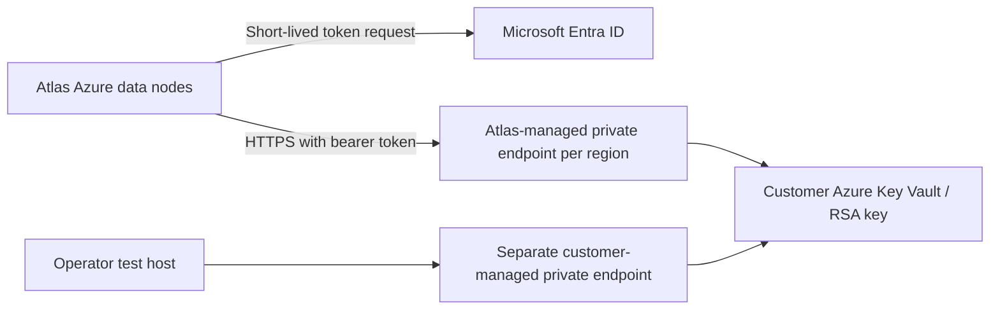

# MongoDB Atlas: Secretless Azure Key Vault Access over Private Endpoints

## 1. Purpose and Architecture

Configure an Azure-hosted MongoDB Atlas deployment to use a customer-managed encryption key in Azure Key Vault (AKV), with:

- **Secretless authentication:** Atlas uses its Azure application and a service principal in your Microsoft Entra tenant. Atlas obtains short-lived tokens; you do not supply a customer-managed client secret.
- **Private key access:** Atlas reaches the vault through Atlas-managed Azure Private Link endpoints, one in every Atlas deployment region.
- **Public vault access disabled:** Apply this after private connectivity and Atlas key access have been verified.

This procedure configures **encryption at rest (EAR)**. It does not configure MongoDB database users, application authentication, CSFLE/Queryable Encryption key access, or application-to-Atlas private endpoints. Those are separate configurations.



Private Link protects the **Key Vault data path**, not every control-plane or token request. Microsoft Entra ID and Atlas Administration API connectivity remain separate requirements.

> Availability warning: Removing key permissions, disabling/deleting a key, or breaking its network path can make encrypted data unavailable and cause Atlas nodes or clusters to shut down. Never use key revocation as a production connectivity test.

## 2. Prerequisites and Change Planning

1. Use an active Atlas project and an **M10 or larger dedicated Azure cluster**. Free and Flex clusters are unsupported.
2. Confirm all relevant project deployments are compatible with Azure-only private CMK networking. MongoDB warns that enabling this feature in a project with multi-cloud clusters disables those multi-cloud clusters.
3. Inventory every Azure region containing cluster nodes. Include planned expansion regions before deploying nodes there.
4. Have **Atlas Project Owner** access. Organization Owner alone is insufficient without the project role.
5. Have an Entra administrator authorized to create the enterprise application/service principal. MongoDB lists Application Developer and application-administration roles; actual ability remains subject to tenant policy.
6. Have Azure authorization to assign roles at the vault/key scope, create/manage the vault and key, and approve private endpoint connections. Subscription Contributor alone does not grant role-assignment rights or key data-plane access. Use an authorized RBAC administrator for assignments.
7. Prepare Azure CLI, `curl`, `jq`, `openssl`, and Postman Desktop for the examples. Shell examples target macOS zsh or bash. `curl --fail-with-body` requires curl 7.76 or later.
8. Prepare an Atlas Administration API service-account access token with the required project permissions and any configured API source-IP access restrictions satisfied. This is a separate credential from Azure Key Vault authentication.
9. For direct curl/Postman tests, prepare a host in a customer Azure VNet, or a workstation connected through VPN/ExpressRoute with working private DNS. You cannot assume access to Atlas's private endpoint from your workstation.
10. Review resource locks on any customer VNet peered with Atlas and its resource group. Such locks can block endpoint creation/deletion with `ScopeLocked`; coordinate narrowly scoped temporary removal. A lock solely on the vault's resource group is not the peered-VNet failure described by MongoDB.
11. Enable Key Vault diagnostic audit logging to an approved Log Analytics workspace or other monitoring destination. Record the change window, cluster names, key retention requirements, and recovery contacts.

**Existing static-credential deployment:** Prefer migrating authentication first, verifying it, and then changing networking. If already private, preserve that networking and follow the migration warning in section 11.

**Network policy:** Do not enable public vault access merely to follow this guide. For a vault that is already private-only, retain that posture and use the combined private-network configuration below; validation completes after endpoint approval and data-node rollout. If an initial save is rejected, use the Atlas private-network setup workflow and escalate to MongoDB Support rather than opening the vault broadly.

## 3. Establish Azure Context and Prepare the Key

### Step 1: Define Environment Values

Replace every placeholder before executing commands. Use public Azure endpoints in this runbook; validate application identity, endpoints, and availability separately for sovereign clouds.

```sh
export SUBSCRIPTION_ID='<azure-subscription-id>'
export RESOURCE_GROUP='<vault-resource-group>'
export KEY_VAULT_NAME='<globally-unique-vault-name>'
export KEY_NAME='atlas-ear-cmk'
export AZURE_LOCATION='centralus'
export ATLAS_PROJECT_ID='<atlas-project-id>'
export ATLAS_AZURE_APP_ID='9efedfcc-2eca-4b27-a613-0cad1e114cb7'
export ATLAS_BASE='https://cloud.mongodb.com/api/atlas/v2'
export KV_API_VERSION='2025-07-01'

az login --tenant '<azure-tenant-id>'
az account set --subscription "$SUBSCRIPTION_ID"
export TENANT_ID=$(az account show --query tenantId -o tsv)
az account show --query '{subscription:id,tenant:tenantId,name:name}' -o json
```

Set `ATLAS_ACCESS_TOKEN` locally through your approved credential workflow. Do not commit it, paste it into tickets, or confuse it with the Azure vault token used later. Avoid shell tracing while handling tokens.

Atlas uses versioned media types. From the current [Atlas API reference](https://www.mongodb.com/docs/api/doc/atlas-admin-api-v2/), select supported versions for Cloud Provider Access, EAR, and EAR private endpoints. The Cloud Provider Access version must support the Azure request fields, and the EAR version must support `azureKeyVault.roleId`.

```sh
export ATLAS_CPA_ACCEPT='application/vnd.atlas.<supported-cpa-version>+json'
export ATLAS_EAR_ACCEPT='application/vnd.atlas.<supported-ear-version>+json'
export ATLAS_PE_ACCEPT='application/vnd.atlas.<supported-private-endpoint-version>+json'
```

These are intentional placeholders, not literal runnable version strings. Do not copy older static-credential API versions without checking secretless field support. Different operations can expose different supported versions.

### Step 2: Register Resource Providers and Inspect the Vault

```sh
az provider register --namespace Microsoft.Network --wait
az provider register --namespace Microsoft.KeyVault --wait

export VAULT_ID=$(az keyvault show \
  --name "$KEY_VAULT_NAME" --resource-group "$RESOURCE_GROUP" \
  --query id -o tsv)

az keyvault show --id "$VAULT_ID" \
  --query '{rbac:properties.enableRbacAuthorization,publicNetworkAccess:properties.publicNetworkAccess,purgeProtection:properties.enablePurgeProtection,softDelete:properties.enableSoftDelete,vaultUri:properties.vaultUri}' \
  -o json
```

If the vault does not exist, create it through your approved Azure provisioning process with RBAC, soft delete, purge protection, diagnostic logging, and the required network controls. Purge protection is a recommended production safeguard. Do not change an existing vault's permission model without assessing every consumer.

### Step 3: Create or Select an RSA Key

Run key data-plane commands from an authorized host with a permitted network path. The key administrator needs separate create permissions, for example an appropriately scoped Key Vault Crypto Officer assignment.

For a new key only:

```sh
az keyvault key create \
  --vault-name "$KEY_VAULT_NAME" \
  --name "$KEY_NAME" \
  --kty RSA --size 2048 \
  --ops encrypt decrypt wrapKey unwrapKey
```

Inspect the key:

```sh
az keyvault key show \
  --vault-name "$KEY_VAULT_NAME" --name "$KEY_NAME" \
  --query '{kid:key.kid,type:key.kty,operations:key.keyOps,attributes:attributes}' -o json

export KEY_IDENTIFIER="https://${KEY_VAULT_NAME}.vault.azure.net/keys/${KEY_NAME}"
```

Confirm it is enabled, currently valid, and supports encrypt/decrypt. Do not rerun creation against an existing production key unintentionally, because that can create a new version.

Use the normal vault hostname and a `/keys/` URI, not a `/secrets/` URI. MongoDB recommends a **versionless** key identifier to resolve the latest version. A versioned identifier is also supported where explicit version pinning is required. Key lifecycle ownership and retention still apply in either case.

## 4. Configure Secretless Identity

### Step 4: Locate or Create the Atlas Enterprise Application

```sh
az ad sp list \
  --filter "appId eq '$ATLAS_AZURE_APP_ID'" \
  --query '[].{objectId:id,applicationId:appId,name:displayName}' -o json
```

If no matching service principal exists, create it:

```sh
az ad sp create --id "$ATLAS_AZURE_APP_ID"
```

Retrieve its tenant-local object ID:

```sh
export SERVICE_PRINCIPAL_OBJECT_ID=$(az ad sp show \
  --id "$ATLAS_AZURE_APP_ID" --query id -o tsv)
```

Distinguish these identifiers:

| Identifier | Meaning | Used For |
| --- | --- | --- |
| `ATLAS_AZURE_APP_ID` | MongoDB-published application ID | Locating/creating the enterprise application |
| `SERVICE_PRINCIPAL_OBJECT_ID` | Object ID of that application's service principal in your tenant | Azure RBAC and Atlas registration |
| `ATLAS_ROLE_ID` | ID returned by Atlas Cloud Provider Access registration | EAR `roleId` |

Do not create a customer client secret, substitute a VM managed identity, or add a federated identity credential for this documented Atlas flow.

### Step 5: Register the Identity with Atlas

```sh
CPA_RESPONSE=$(curl --silent --show-error --fail-with-body \
  --request POST "$ATLAS_BASE/groups/$ATLAS_PROJECT_ID/cloudProviderAccess" \
  --header "Authorization: Bearer $ATLAS_ACCESS_TOKEN" \
  --header "Accept: $ATLAS_CPA_ACCEPT" \
  --header 'Content-Type: application/json' \
  --data "$(jq -n \
    --arg tenant "$TENANT_ID" \
    --arg principal "$SERVICE_PRINCIPAL_OBJECT_ID" \
    --arg app "$ATLAS_AZURE_APP_ID" \
    '{providerName:"AZURE",tenantId:$tenant,servicePrincipalId:$principal,atlasAzureAppId:$app}')")

printf '%s\n' "$CPA_RESPONSE" | jq .
export ATLAS_ROLE_ID=$(printf '%s' "$CPA_RESPONSE" | jq -er '.id')
```

Stop if the request fails or `.id` is absent. Save the returned Atlas role ID in the change record. On repeat runs, inspect existing Cloud Provider Access registrations rather than blindly creating duplicates.

### Step 6: Grant Vault Metadata and Key Permissions

Grant vault metadata access for either permission model:

```sh
az role assignment create \
  --assignee-object-id "$SERVICE_PRINCIPAL_OBJECT_ID" \
  --assignee-principal-type ServicePrincipal \
  --role 'Reader' --scope "$VAULT_ID"
```

For an **RBAC-enabled vault**, grant the cryptographic role at the individual key scope:

```sh
az role assignment create \
  --assignee-object-id "$SERVICE_PRINCIPAL_OBJECT_ID" \
  --assignee-principal-type ServicePrincipal \
  --role 'Key Vault Crypto User' \
  --scope "$VAULT_ID/keys/$KEY_NAME"
```

MongoDB also documents vault-scoped Crypto User access. Key scope reduces exposure when one vault contains unrelated keys. Reader alone cannot perform cryptographic operations; Key Vault Secrets User is not a substitute.

For an **access-policy vault**, use this instead of the Crypto User assignment, retaining the Reader assignment:

```sh
az keyvault set-policy \
  --subscription "$SUBSCRIPTION_ID" \
  --resource-group "$RESOURCE_GROUP" \
  --name "$KEY_VAULT_NAME" \
  --object-id "$SERVICE_PRINCIPAL_OBJECT_ID" \
  --key-permissions get encrypt decrypt wrapKey unwrapKey
```

MongoDB identifies `get`, `encrypt`, and `decrypt` as required key permissions; the access-policy example above follows its published example, which also includes wrap/unwrap. Use an approved custom role if tighter permissions are required. Do not mix permission models or assume access policies apply to an RBAC-enabled vault.

Verify RBAC assignments, including inherited assignments, at both scopes:

```sh
az role assignment list --assignee "$SERVICE_PRINCIPAL_OBJECT_ID" \
  --scope "$VAULT_ID" --include-inherited -o table

az role assignment list --assignee "$SERVICE_PRINCIPAL_OBJECT_ID" \
  --scope "$VAULT_ID/keys/$KEY_NAME" --include-inherited -o table
```

For access policies, inspect `properties.accessPolicies` with `az keyvault show`. Allow Azure permission propagation before proceeding; refresh test tokens after access changes.

## 5. Configure Atlas EAR and Private Networking

### Step 7: Save the Secretless Configuration

In Atlas, open the project and navigate to **Security > Database & Network Access > Advanced**. Under **Encryption at Rest using your Key Management**:

1. Enable the feature and select **Azure Key Vault**.
2. Select **Service Principal (Recommended)**, not Static Credentials. Use the registered identity/role when prompted.
3. Enter subscription ID, resource group, vault name, and key identifier.
4. Enable **Require Private Networking** and save.
5. Continue to **Set up** for private networking.

The API equivalent combines the documented secretless fields with private-network enforcement:

```sh
curl --silent --show-error --fail-with-body \
  --request PATCH "$ATLAS_BASE/groups/$ATLAS_PROJECT_ID/encryptionAtRest" \
  --header "Authorization: Bearer $ATLAS_ACCESS_TOKEN" \
  --header "Accept: $ATLAS_EAR_ACCEPT" \
  --header 'Content-Type: application/json' \
  --data "$(jq -n \
    --arg role "$ATLAS_ROLE_ID" \
    --arg subscription "$SUBSCRIPTION_ID" \
    --arg resourceGroup "$RESOURCE_GROUP" \
    --arg vault "$KEY_VAULT_NAME" \
    --arg key "$KEY_IDENTIFIER" \
    '{azureKeyVault:{enabled:true,roleId:$role,subscriptionID:$subscription,resourceGroupName:$resourceGroup,keyVaultName:$vault,keyIdentifier:$key,azureEnvironment:"AZURE",requirePrivateNetworking:true}}')"
```

Do not add `clientID`, `secret`, or a customer-created client credential to this payload. Review existing settings before patching a production project.

**An accepted PATCH is not proof of working key access.** With private networking, Atlas validates access asynchronously from its data nodes after configuration is applied. Complete endpoint approval and verify rollout and audit evidence below.

### Step 8: Create an Atlas-Managed Endpoint in Every Region

In the Atlas private-network setup wizard, select **every region where cluster nodes are deployed**, then continue. Atlas creates the endpoints in Atlas-managed VNets, not your application subnet.

Alternatively, issue one request per region:

```sh
curl --silent --show-error --fail-with-body \
  --request POST "$ATLAS_BASE/groups/$ATLAS_PROJECT_ID/encryptionAtRest/AZURE/privateEndpoints" \
  --header "Authorization: Bearer $ATLAS_ACCESS_TOKEN" \
  --header "Accept: $ATLAS_PE_ACCEPT" \
  --header 'Content-Type: application/json' \
  --data '{"regionName":"US_CENTRAL"}'
```

`US_CENTRAL` is MongoDB's documented example. Use the **Atlas region identifier** for each deployment region, not an Azure CLI location such as `centralus`. Do not repeat this POST for an endpoint that already exists.

### Step 9: Approve Atlas's Requests in Azure

1. Open **Azure Portal > Key Vault > Networking > Private endpoint connections**.
2. Match each pending request to the endpoint name/connection details shown in Atlas and the intended change. Do not approve unrelated requests.
3. Select each matching request and choose **Approve**.
4. Confirm Azure connection status is **Approved** and provisioning succeeded.
5. Return to Atlas, allow up to approximately three minutes for status reflection, and confirm **ACTIVE** in every required region. Click **Done** in the wizard.

CLI alternative:

```sh
az network private-endpoint-connection list --id "$VAULT_ID" \
  --query '[].{id:id,name:name,status:properties.privateLinkServiceConnectionState.status,endpoint:properties.privateEndpoint.id}' \
  -o json

export CONNECTION_ID='<full-id-of-the-reviewed-pending-connection>'
az network private-endpoint-connection approve \
  --id "$CONNECTION_ID" \
  --description 'Approved Atlas EAR private endpoint under authorized change'
```

The vault can be in a different Azure region than an endpoint. Cross-region placement is supported and is not a cause of `ScopeLocked`.

### Step 10: Enable CMK on Each Cluster

Project-level configuration does not automatically enable CMK for every existing cluster.

1. Open **Database > Clusters** and choose **Edit Configuration** for the target cluster.
2. Expand **Additional Settings**.
3. Set **Manage your own encryption keys** to **Yes**.
4. Verify **Require Private Networking** is **Active**.
5. Review and apply changes; wait for deployment completion and healthy nodes.
6. Repeat for each intended cluster. For new clusters, enable the same option at creation.

Existing clusters already using CMK migrate to the private path after approval. Atlas limits subsequent node deployments to regions with approved endpoints. Review dedicated Search Node encryption separately if those nodes are in scope.

## 6. Verify Atlas Access, Then Disable Public Vault Access

### Step 11: Inspect Atlas Configuration and Endpoint Status

```sh
curl --silent --show-error --fail-with-body \
  "$ATLAS_BASE/groups/$ATLAS_PROJECT_ID/encryptionAtRest" \
  --header "Authorization: Bearer $ATLAS_ACCESS_TOKEN" \
  --header "Accept: $ATLAS_EAR_ACCEPT" | jq '.azureKeyVault'

curl --silent --show-error --fail-with-body \
  "$ATLAS_BASE/groups/$ATLAS_PROJECT_ID/encryptionAtRest/AZURE/privateEndpoints" \
  --header "Authorization: Bearer $ATLAS_ACCESS_TOKEN" \
  --header "Accept: $ATLAS_PE_ACCEPT" | jq .
```

Check the intended `roleId`, vault and key, `enabled: true`, and `requirePrivateNetworking: true`. Check every endpoint's `regionName`, `status`, and `errorMessage`; follow pagination if present. A returned `valid` flag is useful configuration evidence but not a replacement for completed data-node validation.

Confirm cluster changes have completed, nodes are healthy, and there are no EAR validation alerts. In Key Vault audit logs, find successful key operations attributable to the Atlas service principal, correlated with the rollout window and target key. Audit schema varies by diagnostic destination; inspect identity/object-ID fields, operation, result, caller address, and timestamp. Do not infer identity solely from a display name or one caller IP.

### Step 12: Disable Public Data-Plane Access

Only after all required Atlas endpoints are active and Atlas key access has been validated:

```sh
az keyvault update \
  --name "$KEY_VAULT_NAME" --resource-group "$RESOURCE_GROUP" \
  --public-network-access Disabled

az keyvault show --id "$VAULT_ID" \
  --query properties.publicNetworkAccess -o tsv
```

Expected value: `Disabled`. Coordinate with other vault consumers first; they also need private connectivity. If the vault was already private-only, retain that setting throughout.

Recheck Atlas health, EAR alerts, and successful Atlas-identity key activity after enforcement. A normal database ping is useful application-health evidence but does not force a new KMS call, because keys may be cached. Do not restart production nodes solely to generate evidence; use natural/approved lifecycle activity or MongoDB Support guidance.

## 7. Prepare a Private Test Path for curl and Postman

Direct REST tests validate **the caller's identity and network path**, not Atlas's identity or Atlas's private endpoint.

### Step 13: Provide Customer-Side Connectivity

If no operator test path exists:

1. In Azure, create a **separate private endpoint** to the same vault in a customer-owned test/management VNet and subnet. Select resource type `Microsoft.KeyVault/vaults` and subresource `vault`.
2. Approve that connection if it is not automatically approved. This endpoint is additional to the Atlas-managed endpoints.
3. Integrate it with the private DNS zone **`privatelink.vaultcore.azure.net`**, using a DNS zone group where possible, and link the zone to the test host's VNet.
4. Confirm the vault's A record points to the **customer-side endpoint's private IP**, not an Atlas endpoint IP.
5. For VPN/on-premises clients, configure routing and DNS forwarding through an Azure Private DNS Resolver or approved DNS servers that resolve the linked private zone. VNet peering alone does not share private DNS links automatically.
6. Permit the required DNS traffic and HTTPS/TCP 443 along the test path. Do not weaken unrelated NSGs or expose a test VM publicly.

Run from the actual test host:

```sh
nslookup "${KEY_VAULT_NAME}.vault.azure.net"
nc -vz "${KEY_VAULT_NAME}.vault.azure.net" 443
```

The final DNS address must match the reachable customer endpoint's private IP. Keep the **normal vault hostname** in URLs for TLS and service routing. Do not replace it with an IP or the `privatelink` hostname, and do not disable certificate validation.

### Step 14: Authorize a Separate Test Identity

For RBAC, an administrator can temporarily grant the test operator **Key Vault Crypto User** at the same individual key scope. For an access-policy vault, grant the test identity `get`, `encrypt`, and `decrypt`. Record and remove temporary access afterward.

Authenticate interactively without a client secret:

```sh
az login --tenant "$TENANT_ID"
az account set --subscription "$SUBSCRIPTION_ID"
export KV_ACCESS_TOKEN=$(az account get-access-token \
  --tenant "$TENANT_ID" --resource 'https://vault.azure.net' \
  --query accessToken -o tsv)
```

On an appropriately configured Azure VM, `az login --identity` is an alternative, using that VM identity's permissions. It still does not impersonate Atlas.

Never attempt to sign in as the MongoDB-owned application using a fabricated secret. You do not possess its credentials. The vault token audience is `https://vault.azure.net`, not Azure Resource Manager, Microsoft Graph, or Atlas.

## 8. Test with curl

### Test A: Retrieve Key Metadata and Prove the Private Destination

```sh
KEY_RESPONSE=$(curl --silent --show-error --fail-with-body \
  --connect-timeout 10 --max-time 30 \
  --header "Authorization: Bearer $KV_ACCESS_TOKEN" \
  "${KEY_IDENTIFIER}?api-version=${KV_API_VERSION}")

printf '%s\n' "$KEY_RESPONSE" | jq '{kid:.key.kid,type:.key.kty,operations:.key.key_ops,attributes:attributes}'
export TEST_KEY_ID=$(printf '%s' "$KEY_RESPONSE" | jq -er '.key.kid')

curl --silent --show-error --fail-with-body \
  --connect-timeout 10 --max-time 30 \
  --header "Authorization: Bearer $KV_ACCESS_TOKEN" \
  --output /dev/null \
  --write-out 'HTTP %{http_code}; remote IP %{remote_ip}\n' \
  "${TEST_KEY_ID}?api-version=${KV_API_VERSION}"
```

Expected: HTTP `200`, the intended RSA key metadata, and the expected private endpoint destination IP when connecting directly. If a proxy is configured, `remote_ip` may be the proxy rather than the vault endpoint; verify proxy routing or use an approved direct path before claiming private connectivity.

The versioned `TEST_KEY_ID` is intentional: it pins the encrypt/decrypt test to the same key version even if rotation occurs between requests. GET returns metadata/public key material, not the RSA private key.

### Test B: Encrypt a Small Non-Sensitive Value

```sh
export TEST_PLAINTEXT='atlas-akv-private-test'
export PLAINTEXT_B64URL=$(printf '%s' "$TEST_PLAINTEXT" \
  | openssl base64 -A | tr '+/' '-_' | tr -d '=')

ENCRYPT_RESPONSE=$(curl --silent --show-error --fail-with-body \
  --connect-timeout 10 --max-time 30 \
  --request POST "${TEST_KEY_ID}/encrypt?api-version=${KV_API_VERSION}" \
  --header "Authorization: Bearer $KV_ACCESS_TOKEN" \
  --header 'Content-Type: application/json' \
  --data "$(jq -n --arg value "$PLAINTEXT_B64URL" \
    '{alg:"RSA-OAEP-256",value:$value}')")

export CIPHERTEXT_B64URL=$(printf '%s' "$ENCRYPT_RESPONSE" | jq -er '.value')
```

Expected: HTTP `200` with `kid` and a nonempty `value`. `RSA-OAEP-256` is the diagnostic test algorithm here, not a claim about Atlas's internal algorithm. Key Vault RSA encryption operates on one small block, not arbitrary-sized database documents.

### Test C: Decrypt and Compare

```sh
DECRYPT_RESPONSE=$(curl --silent --show-error --fail-with-body \
  --connect-timeout 10 --max-time 30 \
  --request POST "${TEST_KEY_ID}/decrypt?api-version=${KV_API_VERSION}" \
  --header "Authorization: Bearer $KV_ACCESS_TOKEN" \
  --header 'Content-Type: application/json' \
  --data "$(jq -n --arg value "$CIPHERTEXT_B64URL" \
    '{alg:"RSA-OAEP-256",value:$value}')")

DECRYPTED_B64URL=$(printf '%s' "$DECRYPT_RESPONSE" | jq -er '.value')
if [ "$DECRYPTED_B64URL" = "$PLAINTEXT_B64URL" ]; then
  printf '%s\n' 'PASS: encrypt/decrypt round trip matches the original value.'
else
  printf '%s\n' 'FAIL: decrypted value does not match the original value.'
fi
```

Comparing the base64url values avoids platform-specific decoding and padding differences. Run sequentially and stop on any error rather than proceeding with empty response variables.

### Test D: Confirm the Public Path Is Blocked

From an authorized test host **without private routing or private DNS access**, make the metadata request with a valid test-identity vault token. Do not reopen public access. Expected: no successful data-plane response, commonly HTTP `403` with a network-related error such as `ForbiddenByConnection` or `ForbiddenByFirewall`.

A DNS lookup may still return a public address even when public network access is disabled. Public DNS visibility does not mean data access is allowed. A network timeout is not by itself proof that the vault policy blocked the request; correlate the result with configuration and logs. A token-less `401` is not a meaningful public-access denial test.

## 9. Test with Postman

Use **Postman Desktop on the private-connected workstation**. If using the browser interface, select a Desktop Agent running on that workstation. A cloud agent generally cannot reach your private endpoint.

### Step 15: Create a Local Environment

| Variable | Value |
| --- | --- |
| `vaultName` | Your vault name |
| `keyName` | Your key name |
| `kvApiVersion` | `2025-07-01` |
| `kvToken` | Short-lived token obtained in step 14 |
| `testKeyId` | Populated from the metadata response |
| `ciphertext` | Populated from the encrypt response |
| `atlasProjectId` | Atlas project ID |
| `atlasToken` | Separate Atlas Administration API access token |
| `atlasEarAccept` | The resolved `ATLAS_EAR_ACCEPT` media type |
| `atlasPeAccept` | The resolved `ATLAS_PE_ACCEPT` media type |

Store tokens in Postman Vault or local-only sensitive values under your organization's policy. Do not synchronize/export tokens, include them in shared collections, or capture them in screenshots. CLI and Postman must run on hosts with the intended private path; a valid token does not supply connectivity.

### Request 1: GET Key Metadata

- Method: **GET**
- URL: `https://{{vaultName}}.vault.azure.net/keys/{{keyName}}?api-version={{kvApiVersion}}`
- Authorization: **Bearer Token**, value `{{kvToken}}`
- Body: none

Under **Scripts > Post-response** (called Tests in some versions):

```javascript
pm.test("Key metadata returned", function () {
    pm.response.to.have.status(200);
});
if (pm.response.code === 200) {
    const body = pm.response.json();
    pm.expect(body.key.kid).to.be.a("string");
    pm.environment.set("testKeyId", body.key.kid);
}
```

Verify the versioned key ID belongs to the intended vault/key. Confirm private DNS separately from the same workstation; HTTP `200` alone does not identify the network path.

### Request 2: POST Encrypt

- Method: **POST**
- URL: `{{testKeyId}}/encrypt?api-version={{kvApiVersion}}`
- Authorization: **Bearer Token**, value `{{kvToken}}`
- Header: `Content-Type: application/json`
- Body: **raw > JSON**

```json
{
  "alg": "RSA-OAEP-256",
  "value": "YXRsYXMtYWt2LXByaXZhdGUtdGVzdA"
}
```

The value is base64url for `atlas-akv-private-test` without a trailing newline.

Post-response script:

```javascript
pm.test("Encryption succeeded", function () {
    pm.response.to.have.status(200);
});
if (pm.response.code === 200) {
    const body = pm.response.json();
    pm.expect(body.value).to.be.a("string").and.not.empty;
    pm.environment.set("ciphertext", body.value);
}
```

### Request 3: POST Decrypt

- Method: **POST**
- URL: `{{testKeyId}}/decrypt?api-version={{kvApiVersion}}`
- Authorization: **Bearer Token**, value `{{kvToken}}`
- Header: `Content-Type: application/json`
- Body: **raw > JSON**

```json
{
  "alg": "RSA-OAEP-256",
  "value": "{{ciphertext}}"
}
```

Post-response script:

```javascript
pm.test("Decryption succeeded and plaintext matches", function () {
    pm.response.to.have.status(200);
    pm.expect(pm.response.json().value)
        .to.eql("YXRsYXMtYWt2LXByaXZhdGUtdGVzdA");
});
```

Run requests in order and stop on a failed response. All three should return `200`, and the final assertion should pass. Preserve TLS verification. This proves test-identity get/encrypt/decrypt access, not Atlas impersonation.

### Requests 4 and 5: Inspect Atlas from Postman

Use **Bearer Token `{{atlasToken}}`**, not `{{kvToken}}`:

| Method | URL | Accept Header |
| --- | --- | --- |
| GET | `https://cloud.mongodb.com/api/atlas/v2/groups/{{atlasProjectId}}/encryptionAtRest` | `{{atlasEarAccept}}` |
| GET | `https://cloud.mongodb.com/api/atlas/v2/groups/{{atlasProjectId}}/encryptionAtRest/AZURE/privateEndpoints` | `{{atlasPeAccept}}` |

Apply the acceptance checks from step 11. These requests inspect Atlas control-plane state; they do not traverse the vault private endpoint. You can also import the setup curl commands into Postman, resolve their shell variables into Postman variables, and review bodies before sending any state-changing request.

## 10. Troubleshooting

Troubleshoot in this order: **identity and token audience > private DNS > routing/TLS > endpoint approval > Azure permissions/key state > Atlas rollout**. Keep Atlas and operator test paths separate.

| Symptom | Likely Cause | Action |
| --- | --- | --- |
| `az ad sp create` returns permission denied | Wrong tenant, tenant policy, or insufficient Entra privileges | Verify `TENANT_ID`; ask the enterprise application administrator to provision the published Atlas application. Azure subscription Owner does not imply Entra application-management authority. |
| Atlas registration rejects service principal | Application ID supplied instead of object ID, wrong tenant, or unsupported API version | Use tenant-local `az ad sp show ... --query id`; verify the published app ID and Cloud Provider Access version. |
| EAR API rejects `roleId` or media type | API version lacks secretless fields, or malformed request | Select a supported EAR version from the operation reference; preserve exact field casing (`roleId`, `subscriptionID`). Do not fall back to adding a secret. |
| Atlas API `401` or `403` | Atlas token expired, wrong account/project role, or API source-IP restrictions | Refresh the Atlas token and verify project permissions/API access settings. Do not use a Key Vault token against Atlas. |
| Vault REST `401` | Expired token, wrong tenant, or wrong audience | Renew the token with resource `https://vault.azure.net`; do not use an ARM or Atlas token. |
| Vault REST `403`, network-related inner error | Request reached public ingress, unapproved endpoint, or wrong private path | Check public-access setting, endpoint approval, DNS, and proxy behavior. Do not solve this by opening the public firewall. |
| Vault REST `403`, RBAC/access-policy error | Missing data-plane rights, wrong principal/scope/model, or propagation delay | Identify the actual caller; verify key-scoped Crypto User or applicable access policy. Reader only covers metadata at the management plane. Allow propagation and refresh credentials. |
| Key metadata works but encrypt/decrypt fails | Missing crypto permissions, restricted key operations, disabled/expired key, or invalid algorithm | Check get/encrypt/decrypt grants, `key_ops`, enabled/time validity, and RSA compatibility. A successful GET is not sufficient. |
| Encrypt/decrypt `400` | Standard base64 instead of base64url, invalid JSON, oversized RSA block, or mismatched algorithm | Use the small supplied payload and `RSA-OAEP-256`; preserve ciphertext exactly. |
| Decrypt fails after rotation | Encrypt and decrypt used different key versions | Use the versioned `kid` saved from GET/encrypt; keep the original version enabled. |
| Vault REST `404` | Wrong vault/key/version or key deleted | Check the complete `/keys/<name>/<version>` URI and soft-deleted key state. Do not create a replacement and assume it can decrypt old data. |
| DNS resolves to a public IP on the private test host | Missing zone link/A record, corporate resolver, VPN DNS, or split-DNS issue | Verify `privatelink.vaultcore.azure.net`, VNet link, endpoint-specific A record, and forwarding to Azure DNS resolution. |
| DNS is private but TCP 443 times out | VPN/peering/route, NSG, firewall, or stale endpoint IP | Compare DNS IP with the customer endpoint NIC; trace the actual test-host route and permitted traffic. |
| curl/Postman TLS error | IP-based URL, interception/proxy, untrusted certificate chain, or hostname mismatch | Use the normal vault FQDN and approved trust configuration. Never use `curl -k` or disable Postman TLS checks as the fix. |
| Atlas endpoint remains pending | Connection not approved in the vault or wrong request approved | Match Atlas connection name to Azure request; approve each required region and allow status propagation. |
| Endpoint creation/deletion fails with `ScopeLocked` | Lock on peered customer VNet or its resource group | Coordinate temporary removal or narrower locks, retry, approve if creating, then reinstate approved locks. Vault cross-region placement is not the cause. |
| One-region cluster works but expansion fails | Missing active EAR endpoint in the new region | Create/approve that region's endpoint before adding nodes there. |
| Operator curl works but Atlas fails | Different identity, private endpoint, region, or pending data-node validation | Inspect Atlas's service principal grants and Atlas-managed endpoints; correlate Azure audit events and Atlas alerts. Operator success does not prove Atlas access. |
| PATCH succeeded but EAR validation later fails | Private-network validation is asynchronous | Inspect data-node/cluster rollout and alerts, restore correct access promptly, and contact MongoDB Support if service is affected. |
| Rejected/deleted Azure connection reappears | Atlas attempts automatic recreation | For intentional removal, use the Atlas EAR endpoint management workflow. For recovery, approve the new request. |
| CLI works but Postman fails | Cloud agent, different proxy/DNS path, stale token, or unresolved variables | Use Desktop/Desktop Agent on the same connected host; compare resolved URL, token, and proxy configuration. |
| Token acquisition fails but vault endpoint is healthy | Entra connectivity or workload identity conditional-access restriction | Review Entra sign-in logs and policy. MongoDB documents Atlas control-plane/node public-IP considerations for conditional access; these do not require public vault data access. |
| Vault returns `429` or transient `5xx` | Service throttling or transient service problem | Honor `Retry-After`, use bounded backoff, stop repeated manual crypto loops, and check Azure service health. |

### Diagnostic Evidence to Collect

Record UTC timestamps, Atlas project and cluster IDs, Atlas role ID, tenant/service principal object IDs, key ID/version, region, private endpoint connection name/status/error, DNS output from the affected host, HTTP status, error body, and Azure request/correlation IDs. Capture relevant Atlas alerts, Azure Activity Log failures, Key Vault audit events, and Entra sign-in events where available.

Exclude bearer tokens, API secrets, authorization headers, private key material, and sensitive plaintext. Avoid sharing raw `curl -v` output or Postman Console exports without redaction.

## 11. Migration, Recovery, and Lifecycle

### Migrating Existing Static Credentials

1. Register the Atlas service principal and grant/verify permissions before changing EAR.
2. Preserve the existing key, vault, and network settings; update the configuration to use `roleId`.
3. MongoDB documents that failed initial validation retains static credentials and successful validation removes them. **For private networking, validation is asynchronous, so HTTP acceptance is not a safe fallback guarantee.** Follow data-node validation and EAR health closely.
4. Retire the old application secret only after successful migration and confirmation that no other consumer needs it. Never revoke the key or delete the enterprise application as cleanup.

### Recovery

Restore the last known working **permissions, key availability, DNS, or endpoint approval** first. Do not delete/recreate the encryption key. An identically named new key is not the original cryptographic material.

If public access was just disabled and a required consumer fails, follow the approved incident/change process. Prefer repairing private access. Any temporary public exception needs explicit security authorization and narrow controls; it is not the default fix.

Changing vault name, resource group, or subscription requires removing the project's EAR private endpoints first. Treat this as a separate availability-impacting migration with MongoDB Support as appropriate, not a routine field edit.

For intentional CMK decommissioning, MongoDB documents removing all EAR private endpoints, disabling CMK on each cluster, and then disabling it at the project level. Keep key access available throughout and plan network continuity before endpoint removal. Do not disable/delete original keys until dependent data and retained backups no longer require them.

### Ongoing Operations

- Add and approve endpoints before expanding into another region.
- Monitor EAR validation errors, endpoint failures, Entra sign-ins, and Key Vault denials/throttling.
- Manage Azure key rotation explicitly. Versionless identifiers support latest-version resolution, but do not assume immediate re-encryption or that old versions can be deleted.
- Retain old key versions until Atlas changes have deployed and all dependent backup snapshots have expired or been validated against your recovery policy.
- Periodically test a restore using the documented operational process, not by revoking production access.
- Remove temporary operator crypto permissions, clear Postman token/ciphertext variables, and run `unset KV_ACCESS_TOKEN ATLAS_ACCESS_TOKEN` when finished. Do not remove the production Atlas grants.

## 12. Acceptance Checklist

- [ ] Dedicated Azure M10+ deployment and all affected project clusters checked for compatibility.
- [ ] Correct Atlas application service principal registered in the correct tenant; Atlas role ID recorded.
- [ ] Vault metadata Reader plus required key cryptographic permissions verified for the Atlas principal.
- [ ] EAR uses `roleId`, without customer-managed client secrets.
- [ ] Atlas-managed EAR endpoint is ACTIVE in every node region.
- [ ] CMK enabled on every intended cluster; private networking Active; configuration rollout complete.
- [ ] Successful Atlas-identity key activity correlated with deployment, with no EAR validation failures.
- [ ] Vault public network access Disabled; Atlas remains healthy afterward.
- [ ] Separate operator private test path resolves to the correct customer endpoint IP.
- [ ] curl get/encrypt/decrypt passes; private destination verified.
- [ ] Postman Desktop get/encrypt/decrypt passes; final plaintext assertion matches.
- [ ] Validly authenticated public-path test cannot obtain key data.
- [ ] Temporary test permissions and tokens removed; monitoring and backup/key retention ownership recorded.

## 13. References

1. [MongoDB: Manage Customer Keys with Azure Key Vault over Private Endpoints](https://www.mongodb.com/docs/atlas/security/azure-kms-over-private-endpoint/).
2. [MongoDB: Manage Customer Keys with Azure Key Vault (Secretless)](https://www.mongodb.com/docs/atlas/security/azure-kms-secretless/).
3. [MongoDB: Azure Key Vault required access and key lifecycle](https://www.mongodb.com/docs/atlas/security-azure-kms/).
4. [MongoDB: Atlas Administration API access](https://www.mongodb.com/docs/atlas/configure-api-access/).
5. [MongoDB: Atlas Administration API reference](https://www.mongodb.com/docs/api/doc/atlas-admin-api-v2/).
6. [Microsoft: Integrate Key Vault with Azure Private Link](https://learn.microsoft.com/en-us/azure/key-vault/general/private-link-service).
7. [Microsoft: Key Vault REST Encrypt](https://learn.microsoft.com/en-us/rest/api/keyvault/keys/encrypt/encrypt?view=rest-keyvault-keys-2025-07-01).
8. [Microsoft: Key Vault REST Decrypt](https://learn.microsoft.com/en-us/rest/api/keyvault/keys/decrypt/decrypt?view=rest-keyvault-keys-2025-07-01).

**Verification note:** The workflow is grounded in the linked vendor documentation. Commands contain environment-specific placeholders and were not executed against a live Atlas project or Azure tenant. Resolve supported Atlas API media-type versions before execution; validate first in a nonproduction project.